  <picture>
    <source media="(prefers-color-scheme: dark)" srcset="profile/hero-dark.svg"/>
    
  </picture>

  

    
    
    
    
  

I'm **Cesar Reina**, a backend developer from Asunción, Paraguay. I build APIs and cloud systems with **.NET** and **Azure**, and lately spend a lot of time on AI tooling: RAG pipelines, vector search and the Model Context Protocol.

I also teach programming to kids and teenagers, and I like it as much as writing code.

- Backend Developer at **CLT S.A**, building APIs and internal enterprise applications
- Programming Instructor at **Algorithmics**, teaching Python and preparing students for national olympiads
- Studying at **Universidad Americana**
- Previously at **Rugertek S.A**: a scraping platform on Azure Functions and Service Bus, SignalR, Docker Compose and Azure AI

## Stack

  <a href="https://skillicons.dev">
    <picture>
      <source media="(prefers-color-scheme: dark)" srcset="https://skillicons.dev/icons?i=cs%2Cdotnet%2Cazure%2Caws%2Cdocker%2Ckubernetes%2Cgithubactions%2Ccloudflare%2Cpostgres%2Cmongodb%2Credis%2Csqlite%2Cpython%2Cfastapi%2Cflask%2Cts%2Cvue%2Ccpp%2Cbash%2Clinux&perline=10&theme=dark"/>
      
    </picture>
  </a>

Also: ASP.NET Core, gRPC, SignalR, SQL Server, Oracle, Qdrant, .NET MAUI, WinForms, Auth0, Sentry, Azure DevOps.

## Projects

  <a href="https://github.com/Promipi/patitas_felices">
    <picture>
      <source media="(prefers-color-scheme: dark)" srcset="profile/pin-patitas_felices-dark.svg"/>
      
    </picture>
  </a>
  <a href="https://github.com/Promipi/SignalR_ChatPractica">
    <picture>
      <source media="(prefers-color-scheme: dark)" srcset="profile/pin-SignalR_ChatPractica-dark.svg"/>
      
    </picture>
  </a>
  <a href="https://github.com/Promipi/Safari">
    <picture>
      <source media="(prefers-color-scheme: dark)" srcset="profile/pin-Safari-dark.svg"/>
      
    </picture>
  </a>
  <a href="https://github.com/Promipi/Factory">
    <picture>
      <source media="(prefers-color-scheme: dark)" srcset="profile/pin-Factory-dark.svg"/>
      
    </picture>
  </a>

## Activity

  <picture>
    <source media="(prefers-color-scheme: dark)" srcset="https://streak-stats.demolab.com/?user=Promipi&background=0D1117&border=30363D&stroke=30363D&ring=2F81F7&fire=2F81F7&currStreakLabel=2F81F7&currStreakNum=E6EDF3&sideNums=E6EDF3&sideLabels=E6EDF3&dates=8B949E&border_radius=4.5"/>
    
  </picture>
  <picture>
    <source media="(prefers-color-scheme: dark)" srcset="profile/top-langs-dark.svg"/>
    
  </picture>

<picture>
  <source media="(prefers-color-scheme: dark)" srcset="profile/snake-dark.svg"/>
  
</picture>

## Certifications & achievements

- [GitHub Actions](https://www.credly.com/earner/earned/badge/cd5feac0-7070-42ea-a7c5-313fd3635f51) and [GitHub Foundations](https://www.credly.com/earner/earned/badge/a4bab5e8-24f3-4e58-9b56-03dd38dc7f11) certifications (2024)
- National medals in the Physics, Mathematics and Programming olympiads
